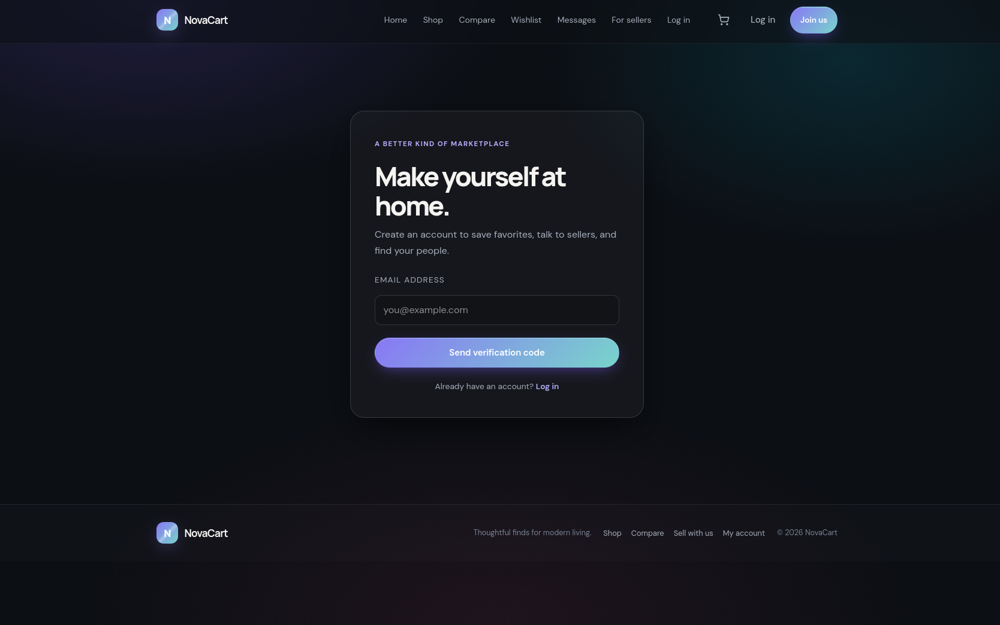

# NovaCart

NovaCart is a Django marketplace with product discovery, seller listings, carts and checkout, wishlists, seller messaging, email verification, and a seller dashboard.

Shopping features include session-based personalized recommendations from recently viewed categories, a four-product side-by-side comparison, and a private customer account area with profile details, order history, saved products, recently viewed items, and conversations.

## Screenshots

### Home page


### Seller page


### Shopping cart


### Sign up



## Get started

### Clone the repository

Install [Git](https://git-scm.com/downloads), then clone this repository:

```sh
git clone https://github.com/fanger9990-star/fangershop.git
cd fangershop
```

Alternatively, open the repository page on GitHub, select **Code**, and choose **Download ZIP**. Extract the ZIP file before opening the project.

### Open the project in VS Code

Install [Visual Studio Code](https://code.visualstudio.com/), then open the project folder:

1. In VS Code, select **File > Open Folder...** and choose the cloned `fangershop` folder.
2. Open the integrated terminal with **Terminal > New Terminal**.
3. If prompted, trust the project folder so VS Code can enable its features.

You can also open a terminal in the project folder and run:

```sh
code .
```

### Install recommended extensions

In VS Code, open the Extensions view with **Ctrl+Shift+X** (Windows/Linux) or **Cmd+Shift+X** (macOS), search for each extension, and select **Install**:

- **Python** by Microsoft (`ms-python.python`) — Python support, interpreter selection, and debugging.
- **Python Debugger** by Microsoft (`ms-python.debugpy`) — Python debugging support.
- **Django** by Baptiste Daroussin (`batisteo.vscode-django`) — Django template syntax support.
- **GitHub Pull Requests** by GitHub (`GitHub.vscode-pull-request-github`) — work with GitHub pull requests and issues in VS Code.

Extensions are optional; the project can also be run from a terminal. To use GitHub features in VS Code, sign in when prompted. To choose the project interpreter, open the Command Palette (**Ctrl+Shift+P** / **Cmd+Shift+P**), run **Python: Select Interpreter**, and select the project's `.venv` interpreter after creating it.

## Run locally

You need Python 3.12 or newer and Git. From the project root, create a virtual environment and install the dependencies:

```sh
python -m venv .venv
. .venv/bin/activate
pip install -r requirements.txt
```

On Windows PowerShell, activate the environment with:

```powershell
.\.venv\Scripts\Activate.ps1
```

If PowerShell prevents activation, you can use the virtual environment's Python directly (for example, `.\.venv\Scripts\python.exe -m pip install -r requirements.txt`).

Copy the sample environment file and adjust the values for your local setup:

```sh
cp .env.example .env
```

Then from the project root:

```sh
set -a
source .env
set +a
python manage.py migrate
python manage.py runserver
```

On Windows PowerShell, copy the sample file with `Copy-Item .env.example .env`. The development settings work without loading `.env`; to set environment variables in PowerShell, use `$env:DJANGO_DEBUG = "True"` and `$env:DJANGO_SECRET_KEY = "local-development-key"` before running `python manage.py migrate` and `python manage.py runserver`.

Open [http://127.0.0.1:8000/](http://127.0.0.1:8000/) in your browser. Stop the development server with **Ctrl+C** in the terminal.

By default, local development prints verification email to the runserver console; it does not deliver email to an inbox. To deliver signup codes through Gmail, enable 2-Step Verification for the Google account, create an App Password, and set these variables in the same terminal that starts Django:

```sh
export DJANGO_DEBUG=True
export DJANGO_SECRET_KEY='your-local-development-key'
export DJANGO_EMAIL_PROVIDER=gmail
export DJANGO_EMAIL_HOST_USER='your-address@gmail.com'
export DJANGO_EMAIL_HOST_PASSWORD='your-16-character-google-app-password'
export DJANGO_DEFAULT_FROM_EMAIL="$DJANGO_EMAIL_HOST_USER"
python manage.py runserver
```

Keep the App Password private; do not commit it or paste it into source files. Gmail uses `smtp.gmail.com:587` with STARTTLS by default. Set `DJANGO_EMAIL_PROVIDER=gmail` explicitly to use this configuration, then restart Django after changing environment variables. SMTP errors are logged server-side and shown as a delivery error on the signup form rather than being treated as a successful send.

For another mail server, set `DJANGO_EMAIL_PROVIDER=smtp` and configure `DJANGO_EMAIL_HOST`, `DJANGO_EMAIL_PORT`, `DJANGO_EMAIL_HOST_USER`, `DJANGO_EMAIL_HOST_PASSWORD`, `DJANGO_EMAIL_USE_TLS`, and `DJANGO_EMAIL_USE_SSL`.

Run the tests with:

```sh
DJANGO_DEBUG=True DJANGO_SECRET_KEY=local-test-key python manage.py test shop
```

## Deployment configuration

Set a stable, high-entropy `DJANGO_SECRET_KEY` outside source control and use `DJANGO_DEBUG=False`. Production startup fails if the secret is missing. Configure `DJANGO_ALLOWED_HOSTS`, `DJANGO_CSRF_TRUSTED_ORIGINS`, and an SMTP backend before enabling email signup. HTTPS redirects, HSTS, and secure session/CSRF cookies are enabled by default when debug mode is off.

`DJANGO_SECURE_HSTS_INCLUDE_SUBDOMAINS` and `DJANGO_SECURE_HSTS_PRELOAD` are opt-in: enable them only after confirming every affected hostname supports HTTPS. Configure static and uploaded media delivery with the production web server or storage service; Django's development server is not intended to serve production traffic.
